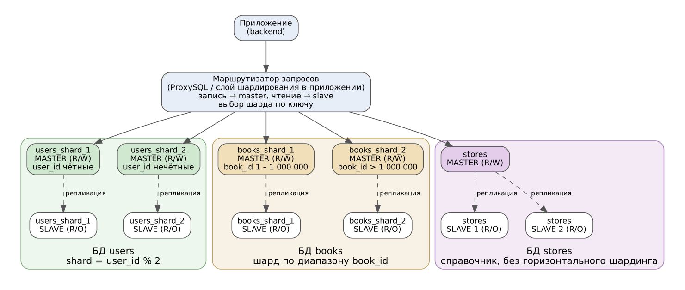
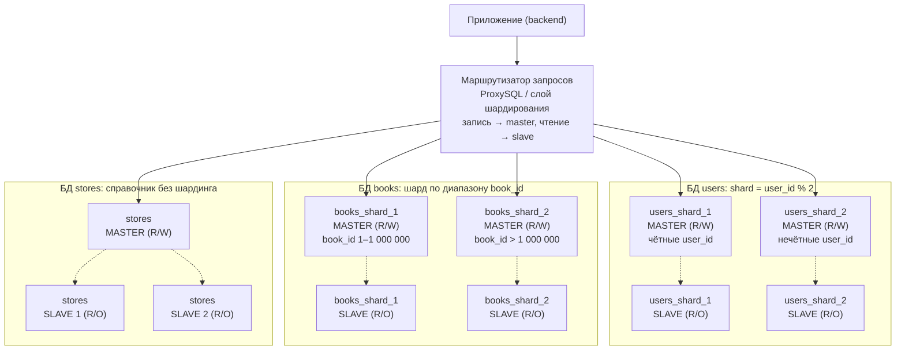

# Домашнее задание к занятию «Репликация и масштабирование. Часть 2»


---

## Задание 1

Опишите основные преимущества использования масштабирования методами:
- активный master-сервер и пассивный репликационный slave-сервер;
- master-сервер и несколько slave-серверов.

### Активный master + пассивный slave

Все запросы — и запись, и чтение — обслуживает master. Slave получает изменения через репликацию и запросы приложения не обслуживает: это «горячий» резерв.

Преимущества:
- **Отказоустойчивость.** При отказе master slave повышается до master (вручную или автоматически, например через Orchestrator или MHA), и сервис восстанавливается за минуты, а не за часы восстановления из бэкапа.
- **Актуальная копия данных.** На slave всегда почти полная копия базы, поэтому при аварии теряется минимум данных.
- **Резервное копирование без нагрузки на master.** Бэкапы, проверки целостности и тестовые выгрузки можно делать со slave, не замедляя рабочий сервер.
- **Простота.** Приложение работает с одним сервером: нет разделения чтения и записи, нет проблем с отставанием реплики при чтении, нет конфликтов.
- **Обслуживание без простоя.** Можно обновить или перенастроить один сервер, переключив нагрузку на другой.

### Master + несколько slave

Master принимает все операции записи. Несколько slave получают изменения и обслуживают запросы на чтение.

Преимущества:
- **Масштабирование чтения.** Нагрузка на чтение распределяется между slave через балансировщик (ProxySQL, HAProxy) или на уровне приложения. Для большинства веб-систем, где чтений намного больше, чем записей, это главный способ масштабирования.
- **Простое горизонтальное расширение.** Чтобы выдержать больше чтений, достаточно добавить ещё один slave, приложение при этом менять не нужно.
- **Разделение нагрузки по назначению.** Отдельные slave можно выделить под тяжёлую аналитику и отчёты, бэкапы или поиск, чтобы они не мешали основной работе.
- **Отказоустойчивость чтения.** Отказ одного slave не останавливает сервис: запросы уходят на остальные. При отказе master любой slave можно повысить до master.
- **Географическое распределение.** Slave можно разместить ближе к пользователям в разных регионах и уменьшить задержку чтения.
- **Разгрузка master.** Master занимается только записью, поэтому запись тоже выполняется быстрее.

---

## Задание 2

Разработайте план для выполнения горизонтального и вертикального шардинга базы данных из трёх таблиц: пользователи, книги, магазины.

### Структура таблиц

```sql
users  (user_id BIGINT PK, name, email, phone, city, created_at)
books  (book_id BIGINT PK, title, author, isbn, price, store_id, created_at)
stores (store_id INT PK, name, city, address, phone)
```

### Вертикальный шардинг

Таблицы разделяются по предметным областям: каждая таблица переезжает в отдельную базу данных на своём сервере (или своей группе серверов).

| База данных | Таблица | Характер нагрузки |
|---|---|---|
| `users_db` | `users` | Много записей (регистрация, обновление профилей), рост вместе с числом пользователей |
| `books_db` | `books` | Самая большая таблица, много чтения (каталог, поиск), регулярная запись |
| `stores_db` | `stores` | Маленький справочник, почти только чтение |

Что это даёт:
- нагрузка на одну таблицу не влияет на другие;
- каждый сервер можно подобрать под свою нагрузку (больше дисков для `books`, больше памяти для `users`);
- каждую базу можно масштабировать и обслуживать независимо.

Ограничения: `JOIN` между таблицами из разных баз невозможен, а внешние ключи между серверами не работают. Связь `books.store_id → stores.store_id` проверяется на уровне приложения. Данные из разных баз объединяются в приложении: например, сначала книги, затем по их `store_id` — магазины. Справочник `stores` маленький, поэтому приложение может держать его в кэше (например, в Redis).

### Горизонтальный шардинг

Строки больших таблиц распределяются между несколькими серверами с одинаковой структурой таблицы. Сервер для строки определяется по ключу шардирования.

**`users` — шардинг по хешу `user_id`:**

| Шард | Правило | Данные |
|---|---|---|
| `users_shard_1` | `user_id % 2 = 0` | чётные `user_id` |
| `users_shard_2` | `user_id % 2 = 1` | нечётные `user_id` |

Хеш (остаток от деления) распределяет пользователей между шардами равномерно. Почти все запросы к пользователю идут по `user_id` (профиль, авторизация после входа), поэтому каждый запрос попадает ровно в один шард. Для входа по email нужна отдельная небольшая таблица-индекс `email → user_id` или поиск по всем шардам.

**`books` — шардинг по диапазону `book_id`:**

| Шард | Правило |
|---|---|
| `books_shard_1` | `book_id` от 1 до 1 000 000 |
| `books_shard_2` | `book_id` больше 1 000 000 |

С диапазонами легко расширяться: когда шард заполнится, для следующего диапазона добавляется новый шард, а старые данные переносить не нужно.

**`stores` горизонтально не шардируется.** Таблица маленькая и почти не меняется, поэтому достаточно одного master и нескольких slave для чтения.

**Маршрутизация.** Между приложением и базами стоит маршрутизатор запросов: ProxySQL с правилами маршрутизации или слой шардирования в самом приложении. Он хранит карту шардов (какие ключи в каком шарде), отправляет запрос в нужный шард по ключу, запись направляет на master, а чтение — на slave.

### Блок-схема



<details>
<summary>Та же схема в Mermaid</summary>



</details>

### Режимы работы серверов

| Сервер | Режим | Что делает |
|---|---|---|
| `users_shard_1`, `users_shard_2` — master | Read/Write | Принимают запись и чтение, которому нужны самые свежие данные, своей части пользователей |
| `users_shard_1`, `users_shard_2` — slave | Read-only (`read_only = ON`) | Асинхронная реплика своего master, обслуживают чтение и служат резервом при отказе master |
| `books_shard_1`, `books_shard_2` — master | Read/Write | Принимают запись своего диапазона книг |
| `books_shard_1`, `books_shard_2` — slave | Read-only | Обслуживают основное чтение каталога, служат резервом |
| `stores` — master | Read/Write | Принимает редкие изменения справочника |
| `stores` — slave 1, slave 2 | Read-only | Обслуживают почти все запросы к справочнику |
| Маршрутизатор | — | Выбирает шард по ключу, разделяет запись (на master) и чтение (на slave) |

Принципы работы системы:
1. **Каждый шард — отдельная пара master-slave** с асинхронной репликацией. При отказе master slave повышается до master, а маршрутизатор переключает на него запись.
2. **Запись идёт только на master** нужного шарда, **чтение — на slave**. Чтение сразу после собственной записи (например, профиль после сохранения) направляется на master, чтобы не попасть на отставание реплики.
3. **Шарды не знают друг о друге.** Нет межсерверных `JOIN` и внешних ключей, связи между данными поддерживает приложение.
4. **Масштабирование:** при росте чтения добавляются slave в нужный шард, при росте записи и объёма — новые шарды (новый диапазон для `books`, увеличение числа шардов для `users` с переносом данных).
